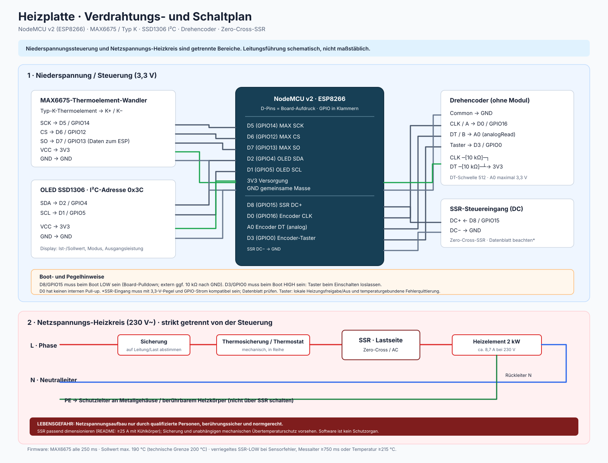

# Flatiron PID-Controlled

Temperaturregelung (z. B. Bügeleisen-/Heizplatte) mit NodeMCU v2 (ESP8266), MAX6675 + Typ-K-Thermoelement, Solid-State-Relais (SSR), OLED, Drehencoder und Weboberfläche.

## Funktionsweise

- **Messung:** MAX6675 liest alle 250 ms die Temperatur (Typ K, 0–1024 °C).
- **Regelung:** PID (`br3ttb/PID`), Ausgang 0–1000 ms pro 1-s-Fenster ("Slow-PWM"). Der Regler wird nur bei neuen 250-ms-Messwerten berechnet; die PID-Messgröße (P und D) nutzt einen 1-s-Tiefpass. Der Integrator bleibt beim Sollwertdurchgang erhalten und wird nur innerhalb eines 40-K-Fehlerbands unterhalb des Sollwerts freigegeben. Das SSR sollte ein **Zero-Cross-SSR** sein.
- **Aufheiz-Boost:** Liegt die Temperatur mehr als `BOOST_MIN_ERROR_C` (25 K) unter dem Sollwert, wird der PID-Ausgang im Automodus auf mindestens `BOOST_OUTPUT_PERCENT` (50 %) angehoben, um das Aufheizen zu verkürzen (erster Test ohne Boost: >10 min bis 150 °C, SSR-Tastgrad kaum über 20 %). Darunter regelt der PID allein; der Boost erhöht nur und senkt nie. Sicherheitsabschaltungen und der Handbetrieb bleiben unverändert. Beide Werte stehen in `src/config.h`: Bei Überschwingen `BOOST_MIN_ERROR_C` erhöhen (30–35 K), bei zu langsamem Aufheizen `BOOST_OUTPUT_PERCENT` erhöhen (z. B. 70 %). Noch nicht am realen Aufbau getestet.
- **Autotune:** Der POST-Endpunkt `/start-tune` verweigert den Start bei Fehler, fehlender/abgelaufener Messung, einer Starttemperatur über 40 °C oder einem Sollwert außerhalb 20–80 °C. Eine vorherige Heizungsfreigabe ist nicht erforderlich. Ein eigener Relay-Test schaltet um den eingestellten Test-Sollwert zwischen 0 % und 15 % mit ±1,5 °C Hysterese. Nach sechs auswertbaren Zyklen werden konservative PID-Vorschläge berechnet; Abbruch bei 120 °C, Sensor-/Plausibilitätsfehler oder nach 10 Minuten. Der Sollwert ist währenddessen gesperrt. Ergebnisse werden nur als Vorschlag angezeigt und niemals automatisch in den PID-Regler übernommen. Die Schwingungs-/Grenzwerte sind Modellannahmen und müssen vor regulärem Einsatz am realen Aufbau geprüft werden.
- **Bedienung:** Drehencoder ändert den Sollwert in 5-°C-Schritten (0–190 °C); der Startwert beträgt 10 °C. Die Weboberfläche bietet Auto (PID) sowie einen ausschließlich beaufsichtigt zu verwendenden manuellen Testmodus mit 0–100 % SSR-Tastgrad im vorhandenen 1-s-Zeitfenster. Der Moduswechsel schaltet die Heizung aus; manuelles Heizen muss danach bewusst eingeschaltet werden. Manuell ist Autotune gesperrt. Nach Boot und Fehlerquittierung ist die Heizung aus und der Modus Auto; die manuelle Prozentvorgabe wird nicht persistent gespeichert. Beide Modi unterliegen weiterhin Sensor-, Übertemperatur- und Fehlerabschaltungen. Der Prozentwert ist ein Tastgrad, keine kalibrierte Angabe der tatsächlichen Heizleistung. Die Heizung kann über die Weboberfläche ein- und ausgeschaltet werden; alternativ bleibt der lokale Encoder-Taster als Ein/Aus-Bedienung verfügbar. Eine Fehlerquittierung nach einem verriegelten Fehler erfordert weiterhin den lokalen Taster und schaltet die Heizung nicht ein. Der POST-Endpunkt `/setpoint` akzeptiert dieselbe Bediengrenze und ändert den Sollwert nicht über 190 °C.
- **OLED:** Beim Start werden Sensor-, WLAN- und Heizungsstatus angezeigt. Die Anzeige bleibt bis zur Encoderbewegung oder zum Tastendruck stehen; danach erscheinen Ist-/Soll-Temperatur, Ausgangsleistung und Heizfreigabe beziehungsweise ein verriegelter Fehlergrund. Bei einem verriegelten Sensorfehler werden Fehlergrund und aktueller Sensorzustand getrennt gezeigt; so bleibt eine inzwischen wieder funktionierende Messung erkennbar, ohne die Fehlerverriegelung aufzuheben. Die Heizungsfreigabe erfolgt über Weboberfläche oder lokalen Taster; nach Fehlerquittierung bleibt sie aus. Ist das Display beim ESP-Start noch nicht per I²C erreichbar, wird die Initialisierung ohne Blockieren der Regelung jede Sekunde erneut versucht.
- **Web:** `http://<IP>/` mit Live-Werten, Heizungs-Ein/Aus-Schalter und Verlaufsdiagramm (2 h, 5-s-Raster). Ausgang, Fehlerverriegelung, Autotunezustand und unverbindliche Parametervorschläge werden angezeigt. Die Weboberfläche und Steuer-Endpunkte haben absichtlich keine Authentifizierung oder Verschlüsselung: Jedes Gerät im WLAN kann die Heizung steuern. Nur in einem privaten, vertrauenswürdigen WLAN ohne Gastzugriff betreiben, niemals aus dem Internet freigeben oder per Portweiterleitung erreichbar machen. Chart.js wird vom CDN geladen (Browser braucht Internet).
- **Sicherheit:** Die Sollwert-Bediengrenze ist 190 °C; 200 °C ist nur eine zusätzliche technische Eingabeobergrenze. Der MAX6675-Rohwert wird einschließlich Thermoelement-offen-/Statusbits geprüft. Ein unplausibler Temperaturanstieg über 20 K/s oder ein fehlender Anstieg von mindestens 0,5 K während 30 s bei mindestens 15 % Ausgang und mindestens 5 K Sollwertabstand verriegelt den Fehler. Ab 215 °C wird das SSR sofort LOW gesetzt. Die 750-ms-Grenze kennzeichnet nur einen nicht mehr aktuellen Messwert und sperrt neue Freigaben; sie ist **kein erreichbarer Sensor-Timeout/Latch** bei synchroner Messung. Nur der lokale Taster kann nach wieder gültiger Messung, Abkühlung unter 60 °C und Ursachenprüfung quittieren; die Quittierung schaltet die Heizung nicht ein. SSR-Pin ist beim Boot LOW. **Loop-Blockaden:** Bei einem Abstand zwischen zwei Regelaufrufen von mindestens 400 ms (`LOOP_STALL_THRESHOLD`) wird nach Wiederaufnahme der Firmware das SSR LOW gesetzt, das Ausgangsfenster zurückgesetzt und sofort neu gemessen; die Blockade wird als `STALL`-Zeile protokolliert. Ein echter Firmware-Hänger kann den SSR-Pegel bis zum Watchdog-Reset halten. Laut Betreiber ist ein externer Dead-Man-Schalter vorhanden und die Schutzkette fachmännisch abgenommen; die Firmware selbst enthält keinen Dead-Man/Heartbeat und kann einen vollständigen Hänger nicht selbst rechtzeitig abschalten. Die unabhängige Schutzkette muss daher funktionsfähig bleiben; die 240-°C-Schmelzsicherung allein wäre kein gleichwertiger Ersatz.
- **Diagnose:** Firmware gibt CSV-Messwerte mit 100-ms-Zeitbasis (Millisekunden, Temperatur, Sollwert, Stellgröße, tatsächlicher SSR-Zustand, lokale Freigabe, Autotune, verriegelter Fehler, aktueller Sensorzustand, MAX6675-Rohwert, 16-Bit-Rohwort, Gültigkeit der letzten Abfrage, Alter der letzten gültigen Messung, Abfragealter und Loop-Abstand) über Serial mit 115200 Baud aus. `reading_age_ms` ist vor dem ersten gültigen Messwert `-1`. Eine zusätzliche `FAULT`-Zeile enthält beim Verriegeln dieselben relevanten Zeitangaben. `Sensorwert ungueltig` bezeichnet ungültige MAX6675-Statusbits oder einen nichtnumerischen/außerhalb des Sensorbereichs liegenden Messwert; `Sensor unplausibel` bezeichnet eine Verletzung der Steigungs- oder Heizwirkungsprüfung. Der separate Hardwaretest gibt jede MAX6675-Abfrage mit Zeitstempel, Rohwort und Status aus. Referenz- und Umgebungstemperatur müssen bei Prüfungen extern erfasst werden. Die Diagrammhistorie im ESP bleibt absichtlich bei 5 s und ist kein Abnahmenachweis.

## Projektstruktur

| Datei                       | Inhalt                                                                  |
| --------------------------- | ----------------------------------------------------------------------- |
| `src/main.cpp`              | `setup()`/`loop()`, WLAN-Verbindung                                     |
| `src/config.h`              | Pins und Konstanten                                                     |
| `src/controller.*`          | Sensor, PID, Autotune, SSR-PWM, Sicherheit, Historie                    |
| `src/max6675_reader.*`      | 16-Bit-Rohwort und Statusprüfung des MAX6675                            |
| `src/ui.*`                  | Encoder und OLED                                                        |
| `src/web_interface.*`       | Webserver-Routen (`/`, `/data`, `/history`, `/heater`, `/mode`, `/manual-output`, `/setpoint`, `/start-tune`, `/cancel-tune`) |
| `src/web_page.h`            | HTML/JS der Weboberfläche                                               |
| `include/secrets.h`         | WLAN-Zugangsdaten (**nicht im Git**)                                    |
| `include/secrets.example.h` | Vorlage dafür                                                           |

## Einrichtung

1. `cp include/secrets.example.h include/secrets.h` und SSID/Passwort eintragen. Weboberfläche und Steuer-Endpunkte sind ohne Zugangsdaten erreichbar; das Gerät deshalb ausschließlich in einem privaten, vertrauenswürdigen WLAN betreiben. Jeder Teilnehmer dieses WLANs kann den Sollwert ändern und die Heizung schalten.
2. `pio run` (nur Build), `pio run -t upload` (Flashen), `pio device monitor` (IP wird seriell ausgegeben).

## Autotune: Beschreibung und Anleitung

Autotune ermittelt PID-Vorschlagswerte mit einem eigenen Relay-Test um den eingestellten Test-Sollwert. Die vorhandenen PID-Parameter werden dabei nicht geändert; ein erfolgreiches Ergebnis erscheint als Vorschlag und muss anschließend bewusst bewertet werden.

1. **Vorbereitung:** Nur beaufsichtigt und nach abgeschlossener elektrischer/sicherheitstechnischer Prüfung starten. Stelle eine unabhängige Temperaturmessung, eine funktionierende externe Temperaturabschaltung und eine sofort erreichbare Netztrennung sicher. Thermoelement korrekt befestigen und die Platte auf höchstens 40 °C abkühlen lassen.
2. **Bedingungen:** Sensor muss gültige, aktuelle Werte liefern. Stelle den Sollwert auf 20–80 °C. Die Heizungsfreigabe muss nicht vorher gesetzt werden; Autotune aktiviert seine begrenzte Testleistung selbst.
3. **Start:** Weboberfläche im Browser öffnen, „Autotune starten“ wählen und die Sicherheitsabfrage bestätigen. Während des Tests ist die Sollwertänderung gesperrt. Der Ausgang wechselt zwischen 0 % und 15 %; die Schaltschwellen liegen ±1,5 °C um den eingestellten Test-Sollwert. Es werden sechs auswertbare Temperaturzyklen benötigt.
4. **Überwachung und Ende:** Die Regelung bricht bei 120 °C, nach 10 Minuten, einem Sensor-/Plausibilitätsfehler oder per lokalem Tastendruck oder dem Webbutton „Autotune abbrechen“ ab. Das einklappbare „Autotune-Log“ auf der Webseite zeigt Statuswechsel, Fehler und Gründe, warum ein Start nicht möglich ist. Die Vorschläge werden aus Relay-Amplitude und Zyklusdauer nach konservativen Regeln berechnet, gegen feste Grenzen geprüft und nicht automatisch übernommen. Währenddessen anwesend bleiben und bei unerwartetem Verhalten die Netztrennung benutzen.
5. **Bericht und Ergebnis:** Die Weboberfläche sammelt währenddessen Messpunkte und speichert nach Abschluss oder erkanntem Abbruch einen zeitgestempelten Bericht in `localStorage` des verwendeten Browsers. Deshalb die Seite geöffnet lassen; der Bericht ist nur auf diesem Browser/Gerät verfügbar. Status, Abbruchgrund, Konfiguration, Start-/Endzustand, Messreihe, Kennzahlen und verfügbarer Temperaturverlauf werden enthalten. Bei erfolgreichem Ergebnis Kp/Ki/Kd als Vorschlag prüfen; die Firmware übernimmt sie nicht automatisch. Nach dem Test bleibt die Heizung ausgeschaltet und kann über die Weboberfläche oder den lokalen Taster wieder freigegeben werden.

## Beschaltungsplan

| Bauteil                  | Pin am Bauteil                | NodeMCU   | GPIO |
| ------------------------ | ----------------------------- | --------- | ---- |
| SSR (Steuereingang +)    | DC+                           | **D8**    | 15   |
| SSR (Steuereingang −)    | DC−                           | GND       |      |
| MAX6675                  | SCK                           | D5        | 14   |
| MAX6675                  | CS                            | D6        | 12   |
| MAX6675                  | SO                            | D7        | 13   |
| MAX6675                  | VCC / GND                     | 3V3 / GND |      |
| OLED SSD1306 (I²C, 0x3C) | SDA                           | D2        | 4    |
| OLED SSD1306             | SCL                           | D1        | 5    |
| OLED                     | VCC / GND                     | 3V3 / GND |      |
| Drehencoder (ohne Modul) | A / CLK                       | D0        | 16   |
| Drehencoder              | B / DT                        | A0        | ADC  |
| Drehencoder              | Common                        | GND       |      |
| Drehencoder-Taster       | Kontakt 1                     | D3        | 0    |
| Drehencoder-Taster       | Kontakt 2                     | GND       |      |
| Pull-up-Widerstände      | CLK und DT jeweils über 10 kΩ | 3V3       |      |

Der [Schaltplan als SVG](docs/schaltplan.svg) zeigt die Pinbelegung aus `src/config.h` und die Regelungs-/Sicherheitsfunktionen aus `src/controller.cpp`. Er ist ein Verdrahtungsplan, keine normgerechte Bau- oder Netzanschlussfreigabe.

### Hinweise zu den Pins (Boot-Sicherheit)

- **D8 (GPIO15)** muss beim Boot LOW sein – genau das, was für das SSR gewünscht ist (Heizung bleibt beim Start aus). Auf dem NodeMCU ist ein Pulldown vorhanden; bei externem Aufbau 10 kΩ nach GND.
- **D3 (GPIO0)** muss beim Boot HIGH sein: Taster nicht beim Einschalten gedrückt halten (Drücken beim Boot = Flash-Modus). **D4 (GPIO2)** wird nicht mehr verwendet (hängt an der Onboard-LED).
- Verwendet wird ein **normaler Drehencoder mit integriertem Taster, ohne Encoder-Modul**. Den gemeinsamen Encoderkontakt an GND anschließen; CLK (D0) und DT (A0) jeweils mit einem externen 10-kΩ-Widerstand nach 3V3 ziehen. D0 (GPIO16) hat keinen internen Pull-up. DT wird an A0 analog gelesen (Schwelle 512); am NodeMCU v2 darf A0 höchstens 3,3 V erhalten.
- Den Taster zwischen D3 (GPIO0) und GND anschließen. D3 ist intern auf HIGH gezogen; den Taster beim Einschalten nicht gedrückt halten, da GPIO0 sonst den Flash-Modus aktiviert. Im Betrieb schaltet ein entprellter Tastendruck die Heizung lokal aus/ein. Bei verriegeltem Fehler quittiert ein Tastendruck nur nach aktueller plausibler Messung und unter 60 °C; anschließend bleibt die Heizung aus und kann über Web oder Taster wieder eingeschaltet werden. Die Ursachenprüfung bleibt Aufgabe der Bedienperson.
- Die Pins D5–D7 und D1/D2 sind beim Boot unkritisch.

### Warum diese Pinbelegung?

Die Zuordnung in `src/config.h` hält das SSR auf einem für den sicheren Start geeigneten Pin und vermeidet, Encoder-Signale auf die weiteren Boot-Strapping-Pins zu legen:

- **SSR an D8 (GPIO15):** GPIO15 muss beim Start LOW sein. Das entspricht dem gewünschten sicheren SSR-Zustand „Heizung aus“; der Pulldown auf dem Board hält den Pegel auch, bevor die Firmware den Ausgang initialisiert.
- **Encoder-Taster an D3 (GPIO0):** Der Taster nutzt den internen Pull-up und liegt im Ruhezustand HIGH. GPIO0 ist trotzdem ein Boot-Strapping-Pin: Ein gedrückter Taster beim Einschalten zieht ihn LOW und verhindert den normalen Programmstart. Im laufenden Betrieb dient der entprellte Taster als lokale Ein/Aus-Bedienung und zur temperaturgebundenen Fehlerquittierung.
- **Encoder-CLK an D0 (GPIO16):** D0 eignet sich als digitaler Eingang für die CLK-Flanke, hat jedoch keinen internen Pull-up. Daher ist der externe 10-kΩ-Pull-up erforderlich.
- **Encoder-DT an A0:** A0 wird verwendet, damit DT nicht auf GPIO2 (D4) gelegt werden muss. GPIO2 muss beim Start HIGH sein und D4 ist außerdem mit der Onboard-LED verbunden; ein Encoder-Signal könnte den erforderlichen Startpegel beeinträchtigen. Die Firmware liest DT deshalb mit `analogRead()` und ordnet Werte anhand der Schwelle 512 einem digitalen LOW- oder HIGH-Pegel zu. Das ist ein Kompromiss der Pinbelegung, kein analoger Ausgang des Encoders.
- **D1/D2 und D5–D7:** Diese Pins übernehmen I²C für das OLED beziehungsweise die drei vom MAX6675 benötigten SPI-Signale. Sie sind für diese Verbindungen geeignet und vermeiden zusätzliche Konflikte mit Boot-Strapping-Pins.

Damit bleiben alle benötigten Funktionen angeschlossen, ohne einen weiteren bootkritischen GPIO als Encoder-Eingang zu verwenden. CLK und DT brauchen weiterhin externe Pull-ups nach 3V3; besonders bei A0 müssen die Spannungsgrenzen des NodeMCU v2 eingehalten werden.

## Hinweise

- **Netzspannung ist lebensgefährlich.** Aufbau nur mit berührungssicherem Gehäuse, Schutzleiter, Sicherung und Thermosicherung; SSR ausreichend dimensionieren (2 kW ≈ 9 A bei 230 V → SSR ≥ 25 A mit Kühlkörper).
- Das Webinterface und die Steuerrouten sind nicht authentifiziert und die Verbindung ist nicht verschlüsselt. Jedes Gerät im WLAN kann steuern; ausschließlich in einem privaten, vertrauenswürdigen WLAN betreiben, nicht in einem Gastnetz und niemals per Portweiterleitung aus dem Internet erreichbar machen.

## Sicherheitsfreigabe vor Netzbetrieb

Die Softwareänderung ist **keine Betriebsfreigabe**. Die 2-kW-Heizung bis zur Prüfung aller folgenden Punkte nicht an Netzlast betreiben:

- Die vorhandene 240-°C-Schmelzsicherung und der externe Dead-Man-Schalter sind laut Betreiber vorhanden; die Schutzkette wurde fachmännisch abgenommen. Änderungen an Heizplatte, Sensor, SSR, Dead-Man oder Verdrahtung erfordern eine erneute Prüfung durch eine Elektrofachkraft. Die Firmwareprüfung ersetzt diese Abnahme nicht.
- Typ-K-Fühler flächig, fest und elektrisch sicher an der relevanten Oberfläche montieren. Sensorposition und heißeste Stellen mit einem zweiten kalibrierten Messmittel vergleichen.
- Ein echtes Zero-Cross-AC-SSR für ohmsche Lasten mit mindestens 25 A Nennstrom, geeignetem Kühlkörper und geprüftem 3,3-V-Steuereingang verwenden. Ein kurzgeschlossenes SSR muss durch unabhängigen Thermoschutz, Sicherung und erreichbare allpolige Netztrennung beherrscht werden.
- Phase passend absichern und über Thermoschutz und SSR führen. Neutralleiter und Schutzleiter nicht schalten; Schutzleiter niederohmig an alle berührbaren Metallteile anschließen. Netz- und Kleinspannung getrennt, zugentlastet, isoliert und berührungssicher aufbauen. Prüfungen und Arbeiten am 230-V-Kreis sind einer qualifizierten Elektrofachkraft vorbehalten.
- Nur auf nicht brennbarer Unterlage und mit freiem Arbeitsbereich betreiben; Kühlkörper freihalten, kein Wasser verwenden und eine erreichbare Netztrennung sowie geeigneten Feuerlöscher bereithalten.

Die Schutzkette wurde laut Betreiber fachmännisch abgenommen. Vor den ersten Regelversuchen mit dieser Firmware trotzdem Sensor- und SSR-Verhalten ohne Heizlast und anschließend beaufsichtigte Niedrigtemperaturversuche mit unabhängiger Temperaturmessung durchführen; danach PWM-Bewertung und schrittweise Regelversuche bis höchstens 190 °C. Autotune erst nach erfolgreichen Regelversuchen testen. Die aktuelle Firmware oder die vorhandenen Raumtemperatur-Hardwaretests belegen die Regelgüte nicht. Nie unbeaufsichtigt betreiben oder das Webinterface als einzige Überwachung verwenden. Beim Booten GPIO0-Taster loslassen; nach einem Fehler erst Netz trennen, abkühlen, Ursache prüfen und lokal quittieren.
